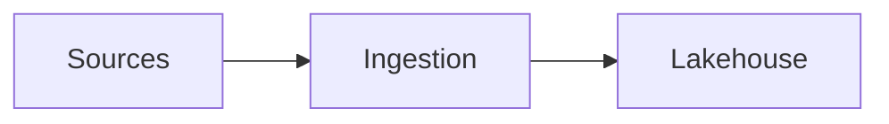

# Documents and template packs

```bash
dsr docs render out/assessment.md --to docx                 # workspace default template
dsr docs render out/assessment.md --to pdf
dsr docs render out/kickoff.md --to pptx --template acme:deck
dsr docs render out/assessment.md --to pdf --via docx       # exact Word branding, via LibreOffice
```

Write Markdown (pandoc flavor) with front matter:

```markdown
---
title: Falcon Platform Assessment
subtitle: Current state and next steps
author: [Platform Team]
date: 2026-11-05
version: "0.9"
template: acme:proposal        # optional: pack and kind for this document
---
```

## Diagrams

````markdown



````

Mermaid blocks are rendered with `mmdc` (it needs a Chromium-family browser:
puppeteer's cached headless shell, Chrome, Chromium, Edge or Brave). draw.io
files (or `drawio` blocks holding diagram XML) are exported with the draw.io
desktop app. Images are PNG for DOCX/PPTX and SVG for PDF, cached by content.

## Outputs

| Format | How |
|---|---|
| DOCX | pandoc with the kind's reference document (styles, header, footer); the kind's cover page in front; `{{tokens}}` filled; the table of contents filled in, with page numbers when LibreOffice is installed |
| PPTX | pandoc with the kind's PowerPoint template (masters, layouts, theme); a new slide at each level-2 heading (`slide-level` in front matter changes it); `::: notes` blocks become speaker notes |
| PDF | pandoc to Typst with the kind's theme; or `--via docx` to render the DOCX and convert it with LibreOffice |

## Template packs

A pack is a folder with `pack.toml`; one workspace can hold several (for example
the client's brand and your firm's). Lookup order: `<workspace>/templates/`,
the user templates folder, then the built-in `neutral` pack.

```toml
name = "acme"
extends = "neutral"          # inherit everything not set here
default_kind = "report"

[defaults]                   # token values unless the document sets them
client = "Acme"
doc_code = "ACME-DOC"

[kinds.report]
docx = "report/reference.docx"
cover = "report/cover.docx"
toc = true

[kinds.proposal]
docx = "proposal/reference.docx"
number_sections = true

[kinds.deck]
pptx = "deck/template.pptx"

[kinds.report.pdf_vars]      # Typst/pandoc variables for PDF
papersize = "a4"
```

Choosing a template: `--template pack:kind`, else the document's `template:`,
else `[docs] template` in `dossier.toml`, else `neutral`. The kind comes from
the same places (or front matter `kind:`), then the pack's `default_kind`.

### Building a client pack

```bash
dsr templates new acme --extends neutral
dsr templates import "Acme report.dotx" --pack acme --kind report
dsr templates import "Acme cover.docx" --pack acme --kind report --role cover \
    --replace "Quarterly Status Report={{title}}" --replace "V1.0={{version}}"
dsr templates import "Acme deck.potx" --pack acme --kind deck
dsr templates inspect acme       # styles, tokens, slide layouts, PDF theme
dsr templates show acme:report   # what each kind resolves to after inheritance
```

`--replace` turns literal text in a branded file into tokens, even when Word
split it across several text runs. Tokens can be any key from the front matter
or the pack's `[defaults]`, plus `title`, `subtitle`, `author`, `date`,
`version`. A token without a value is left empty and reported.

Keep client templates in that client's workspace (`templates/`): they are client
material. Only the brand-free `neutral` pack ships with dossier.

### What `inspect` checks

- DOCX: the styles pandoc relies on (`Title`, `Heading 1-2`, `Body Text`,
  `Table`); tokens; tokens split across runs.
- Cover: its tokens.
- PPTX: the layouts pandoc uses (`Title Slide`, `Title and Content`,
  `Section Header`, `Two Content`, `Comparison`, `Content with Caption`, `Blank`);
  missing ones fall back to pandoc defaults.
- PDF theme: a Typst file defining `#let conf(...)` (see
  `src/dossier/docs/packs/neutral/pdf/theme.typ`).

## Agents

The MCP server lists packs (`templates`). It can render documents
(`render_document`, Markdown inside the workspace to `out/`) only when the
workspace sets `[agent] allow_render = true`.
